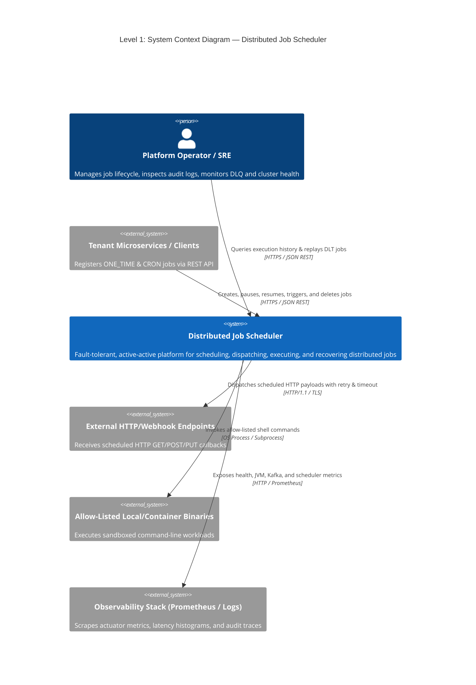
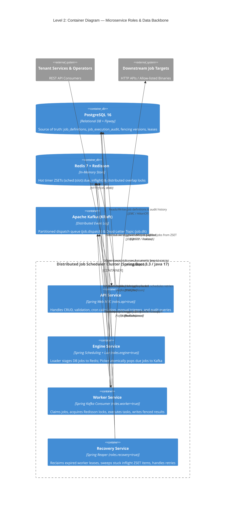
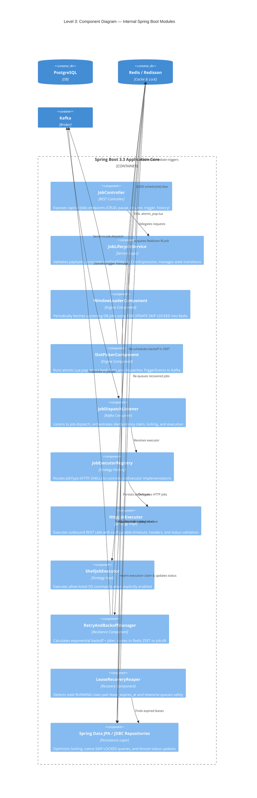
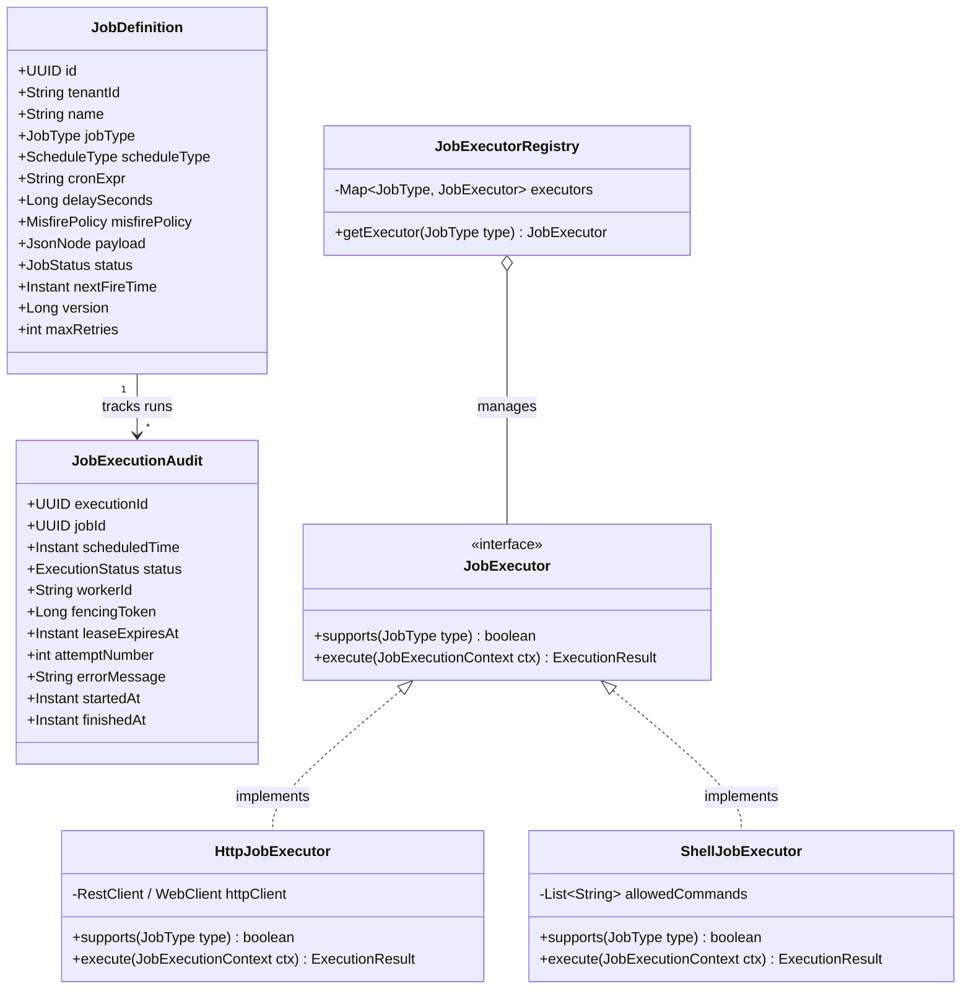
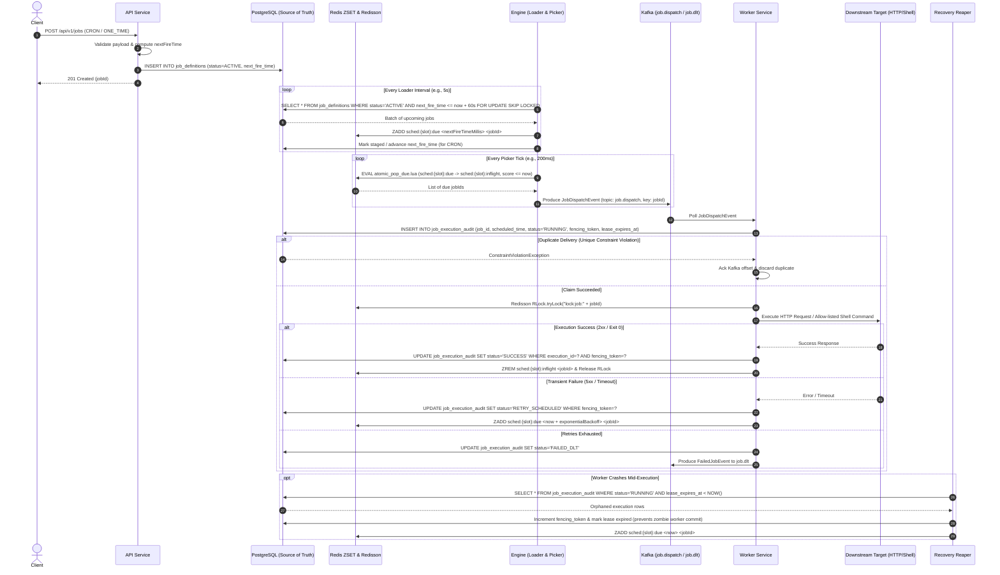

# Distributed Job Scheduler

> **Enterprise-grade, fault-tolerant, horizontally scalable Distributed Job Scheduling & Execution Engine built with Java 17 and Spring Boot 3.3.**

[](https://openjdk.org/projects/jdk/17/)
[](https://spring.io/projects/spring-boot)
[](https://www.postgresql.org/)
[](https://redis.io/)
[](https://kafka.apache.org/)
[](https://flywaydb.org/)

---

## Table of Contents

1. [Executive Overview](#1-executive-overview)
2. [How a Distributed Job Scheduler Works](#2-how-a-distributed-job-scheduler-works)
3. [High-Level Design (HLD) — The C4 Model (Four C's of Abstraction)](#3-high-level-design-hld--the-c4-model-four-cs-of-abstraction)
   - [Level 1: System Context Diagram](#level-1-system-context-diagram)
   - [Level 2: Container Diagram (Microservice Roles & Infrastructure)](#level-2-container-diagram-microservice-roles--infrastructure)
   - [Level 3: Component Diagram (Internal Module Architecture)](#level-3-component-diagram-internal-module-architecture)
   - [Level 4: Code Diagram (Domain State Machine & Core Contracts)](#level-4-code-diagram-domain-state-machine--core-contracts)
4. [Service Relationships & Inter-Service Communication](#4-service-relationships--inter-service-communication)
5. [End-to-End Workflow & Execution Lifecycle](#5-end-to-end-workflow--execution-lifecycle)
6. [Deep-Dive Analysis of Microservice Roles (6 Architectural Parameters)](#6-deep-dive-analysis-of-microservice-roles-6-architectural-parameters)
   - [6.1 API Service (`scheduler.roles.api`)](#61-api-service-schedulerrolesapi)
   - [6.2 Engine Service — Loader & Picker (`scheduler.roles.engine`)](#62-engine-service--loader--picker-schedulerrolesengine)
   - [6.3 Worker Service (`scheduler.roles.worker`)](#63-worker-service-schedulerrolesworker)
   - [6.4 Recovery & Reaper Service (`scheduler.roles.recovery`)](#64-recovery--reaper-service-schedulerrolesrecovery)
   - [6.5 Infrastructure Backbone (PostgreSQL, Redis/Redisson, Kafka)](#65-infrastructure-backbone-postgresql-redisredisson-kafka)
7. [Low-Level Design (LLD)](#7-low-level-design-lld)
   - [Database Schema & Indexing Strategy](#database-schema--indexing-strategy)
   - [Redis Data Structures & Atomic Lua Scripting](#redis-data-structures--atomic-lua-scripting)
   - [Kafka Topics, Partitioning & Dead-Letter Topology](#kafka-topics-partitioning--dead-letter-topology)
   - [REST API Specification](#rest-api-specification)
8. [Design Patterns Used](#8-design-patterns-used)
   - [Java & Object-Oriented Design Patterns](#java--object-oriented-design-patterns)
   - [Microservices & Distributed Systems Design Patterns](#microservices--distributed-systems-design-patterns)
9. [Quick Start & Deployment Guide](#9-quick-start--deployment-guide)
10. [Known Gaps & Production Hardening Checklist](#10-known-gaps--production-hardening-checklist)

---

## 1. Executive Overview

The **Distributed Job Scheduler** is a cloud-native, active-active scheduling platform designed to trigger, dispatch, execute, retry, and recover delayed (`ONE_TIME`) and recurring (`CRON`) workloads across a distributed cluster without single points of failure or duplicate executions.

Rather than relying on heavy database polling at execution time or single-leader bottlenecks, the platform decouples **durable persistence**, **sub-second time indexing**, **asynchronous dispatch**, and **isolated execution** across four independently scalable microservice roles built from a modular monolith/single-codebase architecture (`scheduler.roles.{api,engine,worker,recovery}`):

* **PostgreSQL (Source of Truth):** Stores job definitions, next-fire timestamps, execution audit logs, fencing tokens, and lease metadata.
* **Redis ZSET (Hot Timer Index):** Stores partitioned time-bucketed Sorted Sets (`sched:{slot}:due` and `sched:{slot}:inflight`) for $O(\log N)$ due-job retrieval.
* **Apache Kafka in KRaft Mode (Dispatch Bus):** Decouples timer triggering from worker execution via `job.dispatch` and captures poison/exhausted jobs in `job.dlt`.
* **Redisson (Distributed Coordination):** Enforces mutual exclusion (`RLock`) to prevent concurrent overlapping executions of the same job.

---

## 2. How a Distributed Job Scheduler Works

Running scheduled tasks on a single server (`@Scheduled` or OS `cron`) fails in distributed environments due to **split-brain execution** (all nodes fire the same job simultaneously), **node crashes** (in-memory timers vanish), and **head-of-line blocking** (long-running tasks starve short tasks).

This system solves those problems through a **Four-Stage Pipeline**:

1. **Partitioned Look-Ahead Staging (DB $\rightarrow$ Redis):** Instead of polling PostgreSQL every millisecond, the **Engine Loader** periodically scans PostgreSQL using `FOR UPDATE SKIP LOCKED` for jobs due within an upcoming look-ahead window (e.g., next 60 seconds) and stages their IDs into time-slotted Redis Sorted Sets (`ZADD sched:{slot}:due <epochMillis> <jobId>`).
2. **Atomic Pop-to-Inflight Triggering (Redis Lua):** Every tick (e.g., 100ms–500ms), the **Engine Picker** executes an atomic **Redis Lua script** that queries `ZRANGEBYSCORE` for items with `score <= now`, moves them atomically into `sched:{slot}:inflight`, and returns the claimed batch—eliminating race conditions across N active Engine replicas.
3. **Asynchronous Dispatch & Fenced Execution (Kafka $\rightarrow$ Worker):** Claimed triggers are published to Kafka (`job.dispatch`). **Worker** nodes consume messages, insert an idempotent execution record in PostgreSQL (guarded by a unique constraint on `(job_id, scheduled_time)`), acquire a **Redisson distributed lock** (if overlap is disallowed), execute the payload (`HTTP`, `SHELL`, etc.), and commit the result using a **fencing token / optimistic version check**.
4. **Self-Healing Lease Recovery (Recovery Role):** If a Worker crashes mid-execution (OOM, SIGKILL, network partition), its execution lease expires in PostgreSQL and/or its trigger remains stranded in `sched:{slot}:inflight`. The **Recovery** service detects expired leases, reclaims orphaned runs, and either re-queues them into Redis with exponential backoff or routes them to `job.dlt`.

---

## 3. High-Level Design (HLD) — The C4 Model (Four C's of Abstraction)

The architecture is documented using Simon Brown's **C4 Model** across all four levels of abstraction: **Context**, **Containers**, **Components**, and **Code**.

### Level 1: System Context Diagram

Shows how external actors, tenant client applications, and target downstream systems interact with the Distributed Job Scheduler as a black-box platform.



---

### Level 2: Container Diagram (Microservice Roles & Infrastructure)

Shows the deployable runtime containers. The codebase uses **Role-Based Toggle Decomposition** (`scheduler.roles.{api,engine,worker,recovery}`), allowing each role to be deployed and auto-scaled independently as dedicated microservice containers while sharing domain models.



---

### Level 3: Component Diagram (Internal Module Architecture)

Zooms inside the Spring Boot application to reveal the internal Spring beans, repositories, Lua scripts, strategy executors, and coordination components across the four active roles.



---

### Level 4: Code Diagram (Domain State Machine & Core Contracts)

Illustrates the class-level abstractions (`JobExecutor` strategy hierarchy, domain entities, and finite state transitions) governing job definitions and execution attempts.



---

## 4. Service Relationships & Inter-Service Communication

The four microservice roles share **zero direct synchronous RPC calls** (no brittle REST/gRPC chains between Engine, Worker, and Recovery). Instead, they communicate via **Shared State Synchronization (PostgreSQL + Redis)** and **Asynchronous Event Streaming (Kafka)**, yielding high availability and load leveling.

| Source Service | Target Service / Medium | Communication Protocol | Pattern & Mechanism | Purpose & Payload |
| :--- | :--- | :--- | :--- | :--- |
| **Client / External App** | **API Service** | Synchronous HTTP/1.1 (`REST/JSON`) | Request-Response (`POST`, `PUT`, `GET`, `DELETE`) | Job registration, pause/resume, manual trigger, and execution audit queries. |
| **API Service** | **PostgreSQL** | TCP (`JDBC` / Connection Pool) | ACID Transaction | Persists `JobDefinition`, updates `status` (`PAUSED`/`ACTIVE`), queries `JobExecutionAudit`. |
| **API Service** | **Redis** | TCP (`RESP` / Lettuce) | Direct ZSET Mutation (`ZADD` / `ZREM`) | Immediately enqueues manual triggers (`/trigger`) or evicts `PAUSED`/`DELETED` jobs from `sched:{slot}:due`. |
| **Engine (Loader)** | **PostgreSQL $\rightarrow$ Redis** | `JDBC` + `RESP` | Transactional Outbox / Look-Ahead Staging | Selects due jobs using `FOR UPDATE SKIP LOCKED`, advances staging watermark, and executes `ZADD` into Redis slots. |
| **Engine (Picker)** | **Redis** | TCP (`RESP` / `EVALSHA`) | Atomic Lua Script Execution | Atomically pops due job IDs from `sched:{slot}:due` to `sched:{slot}:inflight` without cross-node lock contention. |
| **Engine (Picker)** | **Kafka (`job.dispatch`)** | TCP (`Kafka Binary Protocol`) | Asynchronous Event Publish (`key = jobId`) | Publishes `JobDispatchEvent` (`jobId`, `scheduledTime`, `fencingToken`, `attempt`) partitioned by `jobId`. |
| **Kafka (`job.dispatch`)** | **Worker Service** | TCP (`Kafka Consumer Group`) | Competing Consumers (Load-Balanced) | Distributes partition load across N active Worker replicas; commits offset only after safe DB claim/dispatch. |
| **Worker Service** | **Redisson (Redis)** | TCP (`RESP` / PubSub) | Distributed Mutual Exclusion (`RLock`) | Acquires `lock:job:{jobId}` (when concurrent overlap is disabled) with watchdog/TTL renewal. |
| **Worker Service** | **PostgreSQL** | TCP (`JDBC`) | Idempotent Insert + Fenced Update | Inserts execution row (`UNIQUE(job_id, scheduled_time)`) and commits completion guarded by `WHERE fencing_token = :token`. |
| **Worker Service** | **Kafka (`job.dlt`)** | TCP (`Kafka Binary Protocol`) | Dead-Letter Queue (DLQ) Publish | Routes jobs that exceed `maxRetries` or encounter non-retryable payload errors for operator inspection. |
| **Recovery Service** | **PostgreSQL & Redis** | `JDBC` + `RESP` | Lease Reaper / Sweeper Loop | Scans `RUNNING` executions where `lease_expires_at < NOW()`, revokes stale fencing tokens, and re-queues to Redis ZSET. |

---

## 5. End-to-End Workflow & Execution Lifecycle

Below is the complete chronological sequence from job creation through execution, failure retry, and dead-letter handling.



---

## 6. Deep-Dive Analysis of Microservice Roles (6 Architectural Parameters)

### 6.1 API Service (`scheduler.roles.api`)

#### 1. Primary Purpose & Key Responsibilities
* **Control Plane Entrypoint:** Acts as the external REST gateway for tenants and operators to create, inspect, pause, resume, manually trigger, and delete scheduled jobs.
* **Validation & Cron Resolution:** Validates JSON payloads, enforces schema rules for `HTTP` and `SHELL` job types, parses Spring 6-field cron expressions (`second minute hour day month weekday`), and calculates initial `next_fire_time`.
* **Immediate Cache Synchronization:** Directly pushes immediate triggers (`POST /api/v1/jobs/{id}/trigger`) into Redis `sched:{slot}:due` and evicts paused/deleted jobs (`ZREM`) so state changes take effect without waiting for the next Loader cycle.

#### 2. Measuring Success (KPIs)
* **API Request Latency:** $p95 < 35\text{ ms}$, $p99 < 80\text{ ms}$ for job creation and state mutations.
* **API Availability:** $\ge 99.95\%$ uptime across active-active replicas behind a load balancer.
* **Validation Rejection Accuracy:** $100\%$ rejection of malformed cron expressions or disallowed job types with HTTP `400 Bad Request` before hitting persistence.
* **Error Rate:** $< 0.1\%$ HTTP `5xx` responses under peak burst traffic.

#### 3. Data Flow, Response Times & Failure Impact
* **Data Flow:** `Client (HTTPS/JSON)` $\rightarrow$ `JobController` $\rightarrow$ `JobLifecycleService` $\rightarrow$ `PostgreSQL (ACID Write)` + `Redis (Optional ZADD/ZREM)` $\rightarrow$ `Client (HTTP 201/200)`.
* **Response Times:** Typical round-trip is `10–30 ms` (1 DB write + 1 optional Redis command).
* **Failure Impact:** If an API instance crashes, load balancers route traffic to healthy replicas immediately (stateless). If **all** API instances go down, **already-scheduled jobs continue firing and executing without interruption** because the Engine and Worker roles operate asynchronously off PostgreSQL, Redis, and Kafka.

#### 4. Technologies, Advantages & Limitations
* **Technologies:** Java 17, Spring Boot 3.3 (`spring-boot-starter-web`), Spring Data JPA / Hibernate, Jackson, Spring `CronExpression`, PostgreSQL JDBC, Redis Lettuce client.
* **Advantages:** Stateless horizontal scaling; instant feedback to callers; decoupled from worker execution backpressure.
* **Limitations:** Synchronous coupling to PostgreSQL availability during write operations; currently lacks built-in RBAC/OAuth2 tenant isolation and rate limiting (see [Known Gaps](#10-known-gaps--production-hardening-checklist)).

#### 5. Scalability & Performance Targets
* **Horizontal Scaling:** Stateless pods scaled via CPU/RPS metrics (target: `1,000+` job registrations/sec per 4-vCPU replica).
* **Connection Pooling:** Tuned HikariCP pool (`maximum-pool-size: 20–30` per instance) to prevent exhausting PostgreSQL `max_connections` when scaling out.

#### 6. Security, Reliability & Compliance
* **Input Sanitization:** Strict deserialization rules (`JobType` enum validation, URL format verification, cron syntax bounds) to prevent injection payloads.
* **Optimistic Concurrency:** Uses `@Version` on `JobDefinition` entities so concurrent `pause` and `resume` API calls never overwrite each other silently.
* **Auditability:** Every mutation updates `updated_at` timestamps, and execution queries (`/history`) expose immutable audit trails for compliance reviews.

---

### 6.2 Engine Service — Loader & Picker (`scheduler.roles.engine`)

#### 1. Primary Purpose & Key Responsibilities
* **Window Loader (DB $\rightarrow$ Redis):** Periodically queries PostgreSQL for `ACTIVE` jobs whose `next_fire_time` falls within a configurable look-ahead window, staging them into time-slotted Redis ZSETs (`sched:{slot}:due`). For `CRON` jobs, advances `next_fire_time` according to the configured `MisfirePolicy` (`FIRE_NOW`, `IGNORE`, etc.).
* **Slot Picker (Redis $\rightarrow$ Kafka):** Runs high-frequency polling loops (`100ms–500ms`) across Redis slots, atomically popping due job IDs (`score <= currentEpochMillis`) into `sched:{slot}:inflight` via Lua and publishing `JobDispatchEvent` messages to Kafka (`job.dispatch`).

#### 2. Measuring Success (KPIs)
* **Scheduling Drift (Trigger Lag):** $p95 < 250\text{ ms}$, $p99 < 500\text{ ms}$ between `scheduledTime` and Kafka `job.dispatch` publish timestamp.
* **Duplicate Trigger Rate:** $0\%$ duplicate dispatch events produced for the same `(jobId, scheduledTime)` pair.
* **Loader Throughput:** Capable of staging $\ge 10,000\text{ jobs/sec}$ from PostgreSQL into Redis ZSETs.
* **Redis Lua Execution Time:** $< 2\text{ ms}$ per atomic pop invocation to avoid blocking Redis's single-threaded command loop.

#### 3. Data Flow, Response Times & Failure Impact
* **Data Flow:**
  * *Loader Path:* `PostgreSQL (SELECT ... FOR UPDATE SKIP LOCKED)` $\rightarrow$ `Engine Loader` $\rightarrow$ `Redis ZADD sched:{slot}:due`.
  * *Picker Path:* `Redis EVAL atomic_pop.lua (due -> inflight)` $\rightarrow$ `Engine Picker` $\rightarrow$ `Kafka Producer (job.dispatch)`.
* **Response Times:** Loader batch cycle: `15–50 ms` per 500 jobs; Picker tick: `2–10 ms` including Kafka async ack.
* **Failure Impact:** Active-active design means if one Engine replica dies mid-tick, remaining replicas immediately claim unlocked DB rows (`SKIP LOCKED`) and pop remaining Redis slots. Any item moved to `sched:{slot}:inflight` before a crash is recovered by the Recovery role.

#### 4. Technologies, Advantages & Limitations
* **Technologies:** Spring Scheduling (`@Scheduled` / `TaskScheduler`), PostgreSQL `SKIP LOCKED`, Redis Sorted Sets (`ZSET`), server-side Redis Lua scripting (`DefaultRedisScript`), Spring Kafka `KafkaTemplate` (`acks=all`, idempotent producer).
* **Advantages:** Eliminates global leader election (no ZooKeeper/Raft leader bottleneck); $O(\log N)$ timer lookups in Redis instead of expensive `B-Tree` range scans every 100ms in PostgreSQL.
* **Limitations:** Relies on synchronized wall-clock time (NTP) across Engine nodes; large batch sizes in a single Lua script can briefly spike Redis latency if slot counts are not balanced.

#### 5. Scalability & Performance Targets
* **Slot Sharding:** Redis keys are partitioned across `N` slots (`sched:{0..N-1}:due`), allowing multiple Engine Picker threads/nodes to scan disjoint slots concurrently without contention.
* **Throughput Target:** `25,000+` triggers/sec across a 3-node Engine cluster with bounded batch sizes (`LIMIT 500` per tick).

#### 6. Security, Reliability & Compliance
* **Idempotent Kafka Producer:** Configured with `enable.idempotence=true` and `acks=all` so network retries between Engine and Kafka never duplicate trigger records in `job.dispatch`.
* **At-Least-Once Guarantee:** Items remain in `sched:{slot}:inflight` until Kafka broker acknowledgment succeeds, ensuring zero silent drops on transient broker hiccups.

---

### 6.3 Worker Service (`scheduler.roles.worker`)

#### 1. Primary Purpose & Key Responsibilities
* **Idempotent Execution Claiming:** Consumes `JobDispatchEvent` from `job.dispatch` and attempts an atomic `INSERT` into `job_execution_audit` constrained by `UNIQUE(job_id, scheduled_time)`.
* **Concurrency & Overlap Control:** Acquires a Redisson distributed lock (`RLock`) keyed by `jobId` when overlapping executions are prohibited.
* **Pluggable Payload Execution:** Delegates execution to strategy implementations (`HttpJobExecutor`, `ShellJobExecutor`).
* **Fenced Status Commit & Retry Routing:** Updates final status (`SUCCESS`, `RETRY_SCHEDULED`, `FAILED_DLT`) guarded by a monotonic `fencingToken`, schedules exponential backoff retries into Redis ZSET, or routes exhausted failures to `job.dlt`.

#### 2. Measuring Success (KPIs)
* **Worker Claim-to-Start Latency:** $p95 < 50\text{ ms}$ from Kafka message consumption to target invocation start.
* **Duplicate Execution Rate:** $0\%$ (strictly prevented by DB unique constraint + Redisson `RLock`).
* **Zombie Write Prevention Rate:** $100\%$ rejection of late status updates from GC-paused workers whose lease was already reclaimed.
* **Executor Success & Retry Accuracy:** Accurate classification of transient (`5xx`, `SocketTimeoutException`) vs. terminal (`4xx`, invalid config) errors.

#### 3. Data Flow, Response Times & Failure Impact
* **Data Flow:** `Kafka (job.dispatch)` $\rightarrow$ `Worker Consumer` $\rightarrow$ `PostgreSQL (Claim Row + Lease)` $\rightarrow$ `Redisson (RLock)` $\rightarrow$ `Downstream Target (HTTP/Shell)` $\rightarrow$ `PostgreSQL (Fenced Update)` + `Redis (ZREM inflight / ZADD retry)` or `Kafka (job.dlt)`.
* **Response Times:** Framework overhead is `5–15 ms`; total execution duration depends on external target latency (bounded by configurable HTTP/Shell timeouts).
* **Failure Impact:** If a Worker crashes or hangs, its PostgreSQL lease (`lease_expires_at`) expires and its Redisson lock TTL lapses; the Recovery service reclaims the run without human intervention.

#### 4. Technologies, Advantages & Limitations
* **Technologies:** Spring Kafka (`@KafkaListener`), Redisson (`RLock`), PostgreSQL Unique Constraints & Fencing Tokens, Java `HttpClient` / Spring `RestClient`, `ProcessBuilder` (for allow-listed `SHELL` jobs).
* **Advantages:** Complete isolation between scheduling cadence and slow downstream I/O; horizontal auto-scaling driven directly by Kafka consumer lag.
* **Limitations:** Long-running synchronous HTTP/Shell tasks occupy consumer threads unless bounded by strict read/execution timeouts (`max.poll.interval.ms` tuning required to avoid unintended Kafka consumer group rebalances).

#### 5. Scalability & Performance Targets
* **Partition-Aligned Scaling:** Scales linearly up to the partition count of `job.dispatch` (e.g., `32` or `64` partitions), with virtual threads or bounded worker pools handling I/O-bound HTTP callbacks at `5,000+` concurrent executions.
* **Backpressure Control:** Kafka `max.poll.records` throttles ingestion when downstream targets slow down.

#### 6. Security, Reliability & Compliance
* **Fencing Tokens:** Every execution claim receives a monotonic `fencing_token`. Status updates execute `UPDATE ... WHERE execution_id = ? AND fencing_token = ?`, preventing a stalled "zombie" worker from overwriting a recovered worker's result.
* **Sandboxed Shell Execution:** `ShellJobExecutor` is **disabled by default** and enforces a strict command allow-list when enabled to mitigate Remote Code Execution (RCE) risks.
* **SSRF Hardening (Recommended):** Outbound `HttpJobExecutor` targets should restrict private/link-local CIDR blocks (`169.254.169.254`, `10.0.0.0/8`) in multi-tenant deployments.

---

### 6.4 Recovery & Reaper Service (`scheduler.roles.recovery`)

#### 1. Primary Purpose & Key Responsibilities
* **Expired Lease Detection:** Periodically scans `job_execution_audit` for records stuck in `RUNNING` state where `lease_expires_at < NOW()`.
* **Fencing Token Invalidation:** Atomically increments the `fencing_token` and transitions the orphaned attempt to `TIMED_OUT / RECOVERING` so the original worker cannot commit stale state if it wakes up.
* **Orphan Inflight Sweeping & Re-Enqueue:** Sweeps stranded entries in Redis `sched:{slot}:inflight` that never materialized in PostgreSQL and re-queues recoverable jobs into `sched:{slot}:due` (or `job.dlt` if `attemptNumber >= maxRetries`).

#### 2. Measuring Success (KPIs)
* **Mean Time to Detection (MTTD) of Dead Workers:** $\le \text{Lease TTL} + \text{Reaper Interval}$ (typically $< 30–60\text{ seconds}$).
* **Orphaned Job Recovery Rate:** $100\%$ of crashed/partitioned executions reclaimed within SLA.
* **False-Positive Reclamation Rate:** $< 0.01\%$ (ensured by worker lease heartbeat renewals on long-running jobs).

#### 3. Data Flow, Response Times & Failure Impact
* **Data Flow:** `PostgreSQL (SELECT ... WHERE status='RUNNING' AND lease_expires_at < NOW() FOR UPDATE SKIP LOCKED)` $\rightarrow$ `Recovery Reaper` $\rightarrow$ `PostgreSQL (Increment fencing_token & audit)` + `Redis (ZADD sched:{slot}:due)` or `Kafka (job.dlt)`.
* **Response Times:** Reaper sweep cycle completes in `10–40 ms` per batch.
* **Failure Impact:** If the Recovery service goes down temporarily, active jobs continue running normally; only **crash recovery** of failed workers is delayed until a Recovery replica restarts.

#### 4. Technologies, Advantages & Limitations
* **Technologies:** Spring Scheduling, PostgreSQL `FOR UPDATE SKIP LOCKED`, Atomic SQL Fencing Updates, Redis ZSET commands, Kafka Producer (`job.dlt`).
* **Advantages:** Self-healing cluster behavior without manual operator intervention; immune to split-brain because database row locks and fencing tokens serialize recovery decisions.
* **Limitations:** Recovery latency is bounded by the configured lease duration—setting leases too short risks reclaiming slow-but-healthy jobs unless lease heartbeats are active.

#### 5. Scalability & Performance Targets
* **Active-Active Safe:** Multiple Recovery replicas can run concurrently because `FOR UPDATE SKIP LOCKED` ensures each replica claims disjoint expired execution rows.
* **Sweep Capacity:** Reclaims `1,000+` orphaned executions per sweep cycle with minimal DB CPU overhead via composite partial indexing on `(status, lease_expires_at)`.

#### 6. Security, Reliability & Compliance
* **Audit Continuity:** Never deletes crashed execution records; marks the crashed attempt as `LEASE_EXPIRED` and creates a new attempt with an incremented `attempt_number` and `fencing_token` for complete forensic traceability.

---

### 6.5 Infrastructure Backbone (PostgreSQL, Redis/Redisson, Kafka)

#### 1. Primary Purpose & Key Responsibilities
* **PostgreSQL:** Authoritative ACID persistence for job configurations, schedule metadata, execution audit history, idempotency keys, and fencing tokens.
* **Redis + Redisson:** Sub-millisecond time-ordered priority queues (`ZSET`) for due/inflight jobs and distributed mutual exclusion (`RLock`) for overlap prevention.
* **Apache Kafka (KRaft):** Durable, partitioned commit log decoupling timer evaluation from worker execution and isolating poison messages (`job.dlt`).

#### 2. Measuring Success (KPIs)
* **PostgreSQL Query Latency:** $p99 < 10\text{ ms}$ for indexed `SKIP LOCKED` scans and fenced updates.
* **Redis Operations Latency:** $p99 < 1.5\text{ ms}$ for `ZADD`, `ZREM`, Lua scripts, and Redisson `RLock`.
* **Kafka End-to-End Dispatch Latency:** $p99 < 15\text{ ms}$ from broker append to consumer fetch; consumer lag maintained near `0` under steady load.

#### 3. Data Flow, Response Times & Failure Impact
* **PostgreSQL Failure:** Halts new job creation, staging, and status commits until primary failover completes (no data loss with synchronous replication).
* **Redis Failure:** Temporarily pauses timer triggering and overlap locking; upon Redis recovery/failover, the Engine Loader rebuilds the hot timer ZSET directly from PostgreSQL (`next_fire_time`), treating Redis as a **recoverable cache/index**.
* **Kafka Failure:** Temporarily buffers triggers in `sched:{slot}:inflight` until brokers recover; zero trigger loss.

#### 4. Technologies, Advantages & Limitations
* **Technologies:** PostgreSQL 16 + Flyway migrations, Redis 7 + Lua + Redisson 3.x, Apache Kafka in ZooKeeper-less KRaft mode.
* **Advantages:** Best-of-breed storage per access pattern—relational ACID where consistency matters, in-memory ZSETs where $O(\log N)$ time ordering matters, and partitioned logs where throughput matters.
* **Limitations:** Operational footprint requires maintaining three stateful infrastructure clusters in production.

#### 5. Scalability & Performance Targets
* **PostgreSQL:** Partition `job_execution_audit` by time (`RANGE (scheduled_time)`) for high-volume retention pruning without `VACUUM` bloat.
* **Redis:** Cluster/sharded across hash slots (`sched:{slot}:due`) to scale memory and single-threaded CPU throughput.
* **Kafka:** Partitioned by `jobId` (`32+` partitions) to preserve per-job ordering while maximizing worker parallelism.

#### 6. Security, Reliability & Compliance
* **Encryption in Transit & At Rest:** TLS for JDBC, Redis (`rediss://`), and Kafka (`SASL_SSL`), paired with disk-level encryption for PostgreSQL volumes and Kafka logs.
* **Schema Governance:** Flyway enforces versioned, deterministic DDL migrations on startup.

---

## 7. Low-Level Design (LLD)

### Database Schema & Indexing Strategy

Managed automatically via **Flyway** (`src/main/resources/db/migration`).

```sql
-- Core Job Definitions Table
CREATE TABLE job_definitions (
    id              UUID PRIMARY KEY,
    tenant_id       VARCHAR(64)  NOT NULL,
    name            VARCHAR(128) NOT NULL,
    job_type        VARCHAR(32)  NOT NULL, -- HTTP, SHELL
    schedule_type   VARCHAR(32)  NOT NULL, -- ONE_TIME, CRON
    cron_expr       VARCHAR(64),
    delay_seconds   BIGINT,
    misfire_policy  VARCHAR(32)  NOT NULL DEFAULT 'FIRE_NOW',
    payload         JSONB        NOT NULL,
    status          VARCHAR(32)  NOT NULL DEFAULT 'ACTIVE', -- ACTIVE, PAUSED, COMPLETED, DELETED
    next_fire_time  TIMESTAMPTZ,
    max_retries     INT          NOT NULL DEFAULT 3,
    allow_overlap   BOOLEAN      NOT NULL DEFAULT FALSE,
    version         BIGINT       NOT NULL DEFAULT 0,
    created_at      TIMESTAMPTZ  NOT NULL DEFAULT NOW(),
    updated_at      TIMESTAMPTZ  NOT NULL DEFAULT NOW()
);

-- Covering index for Engine Loader look-ahead queries
CREATE INDEX idx_job_definitions_active_next_fire
    ON job_definitions (next_fire_time)
    WHERE status = 'ACTIVE';

-- Immutable Execution Audit & Lease Table
CREATE TABLE job_execution_audit (
    execution_id     UUID PRIMARY KEY,
    job_id           UUID         NOT NULL REFERENCES job_definitions(id),
    scheduled_time   TIMESTAMPTZ  NOT NULL,
    status           VARCHAR(32)  NOT NULL, -- RUNNING, SUCCESS, RETRY_SCHEDULED, LEASE_EXPIRED, FAILED_DLT
    worker_id        VARCHAR(128),
    fencing_token    BIGINT       NOT NULL DEFAULT 1,
    lease_expires_at TIMESTAMPTZ,
    attempt_number   INT          NOT NULL DEFAULT 1,
    http_status      INT,
    error_message    TEXT,
    started_at       TIMESTAMPTZ  NOT NULL DEFAULT NOW(),
    finished_at      TIMESTAMPTZ,
    CONSTRAINT uq_job_scheduled_attempt UNIQUE (job_id, scheduled_time, attempt_number)
);

-- Partial index for fast Recovery Reaper scans
CREATE INDEX idx_execution_audit_expired_leases
    ON job_execution_audit (lease_expires_at)
    WHERE status = 'RUNNING';
```

### Redis Data Structures & Atomic Lua Scripting

* **Key Naming Convention:**
  * `sched:{slot}:due` — Redis `ZSET` where `member = jobId:scheduledEpochMs` and `score = triggerEpochMs`.
  * `sched:{slot}:inflight` — Redis `ZSET` where `member = jobId:scheduledEpochMs` and `score = poppedEpochMs` (tracks unacknowledged dispatches).
  * `lock:job:{jobId}` — Redisson `RLock` preventing concurrent execution overlap.

* **Atomic Pop-to-Inflight Lua Script (`atomic_pop_due.lua`):**
  Guarantees that across $N$ Engine Picker replicas, exactly one node pops a due job into `inflight` in a single atomic Redis transaction:

```lua
-- KEYS[1] = sched:{slot}:due
-- KEYS[2] = sched:{slot}:inflight
-- ARGV[1] = currentEpochMillis
-- ARGV[2] = batchLimit

local dueItems = redis.call('ZRANGEBYSCORE', KEYS[1], '-inf', ARGV[1], 'LIMIT', 0, ARGV[2])
if #dueItems == 0 then
    return {}
end

for i, item in ipairs(dueItems) do
    redis.call('ZREM', KEYS[1], item)
    redis.call('ZADD', KEYS[2], ARGV[1], item)
end

return dueItems
```

### Kafka Topics, Partitioning & Dead-Letter Topology

| Topic Name | Partition Key | Partitions (Recommended) | Retention | Purpose |
| :--- | :--- | :--- | :--- | :--- |
| `job.dispatch` | `jobId` | `32` | `24 hours` | Primary work queue carrying `JobDispatchEvent` payloads to Worker nodes. Partitioning by `jobId` preserves ordering for sequential runs of the same job. |
| `job.dlt` | `jobId` | `8` | `14 days` | Dead-Letter Topic capturing jobs that exhausted `maxRetries` or failed deserialization/validation for operator alerting and manual replay. |

### REST API Specification

| Method | Endpoint | Description | Request / Response Highlights |
| :--- | :--- | :--- | :--- |
| `POST` | `/api/v1/jobs` | Register a `ONE_TIME` or `CRON` job | Body: `tenantId`, `name`, `jobType`, `scheduleType`, `cronExpr`/`delaySeconds`, `misfirePolicy`, `payload`. Returns `201 Created` + `id`. |
| `GET` | `/api/v1/jobs/{id}` | Retrieve job definition & current status | Returns `JobDefinition` metadata, `nextFireTime`, and `status`. |
| `PUT` | `/api/v1/jobs/{id}/pause` | Pause an `ACTIVE` job | Sets `status = PAUSED` in PostgreSQL and removes pending entry from Redis `due` ZSET. |
| `PUT` | `/api/v1/jobs/{id}/resume` | Resume a `PAUSED` job | Recomputes `nextFireTime` per `misfirePolicy`, sets `status = ACTIVE`, stages into Redis. |
| `POST` | `/api/v1/jobs/{id}/trigger` | Trigger an immediate out-of-band run | Enqueues `jobId` into Redis `sched:{slot}:due` with `score = now`. |
| `GET` | `/api/v1/jobs/{id}/history` | Fetch paginated execution audit logs | Returns `JobExecutionAudit` list (`status`, `attemptNumber`, `fencingToken`, `startedAt`, `finishedAt`, `errorMessage`). |
| `DELETE` | `/api/v1/jobs/{id}` | Soft-delete/cancel a job | Sets `status = DELETED` and purges from Redis `due` ZSET. |

---

## 8. Design Patterns Used

### Java & Object-Oriented Design Patterns

| Pattern | Where Applied | Architectural Benefit |
| :--- | :--- | :--- |
| **Strategy Pattern** | `JobExecutor` interface with `HttpJobExecutor` and `ShellJobExecutor` implementations | Encapsulates execution protocols behind a uniform contract; adding a `GrpcJobExecutor` or `SqlJobExecutor` requires zero changes to the Worker orchestration flow. |
| **Factory / Registry Pattern** | `JobExecutorRegistry` (auto-wired `Map<JobType, JobExecutor>`) | Dynamically resolves the matching `JobExecutor` bean at runtime based on the job's `JobType` enum without `if/else` or `switch` chains. |
| **Template Method Pattern** | Worker execution lifecycle (`claim -> lock -> execute -> fence commit / retry`) | Standardizes idempotency checks, lease acquisition, metrics timing, and error handling around variable payload execution steps. |
| **Builder Pattern** | Domain entities, DTOs, and `JobExecutionContext` construction | Ensures immutable, readable construction of multi-field scheduling configurations and execution contexts. |
| **State Pattern (Finite State Machine)** | `JobStatus` (`ACTIVE -> PAUSED -> ACTIVE -> COMPLETED/DELETED`) and `ExecutionStatus` (`RUNNING -> SUCCESS / RETRY_SCHEDULED / LEASE_EXPIRED / FAILED_DLT`) | Enforces valid lifecycle transitions and prevents illegal state mutations (e.g., triggering a `DELETED` job). |

### Microservices & Distributed Systems Design Patterns

| Pattern | Where Applied | Architectural Benefit |
| :--- | :--- | :--- |
| **Modular Monolith / Role-Based Deployment** | Single codebase split via `scheduler.roles.{api,engine,worker,recovery}` | Eliminates duplicated domain models and version drift while allowing each role to scale independently in Kubernetes/Docker. |
| **Transactional Outbox / Look-Ahead Staging** | Engine Loader (`PostgreSQL SKIP LOCKED -> Redis ZSET`) | Guarantees durable persistence in PostgreSQL before any timer is indexed in Redis, preventing job loss if Redis restarts. |
| **Competing Consumers Pattern** | Kafka consumer group on `job.dispatch` across N Worker replicas | Automatically load-balances job execution across workers and rebalances partitions if a worker node fails. |
| **Distributed Lock & Fencing Token Pattern** | Redisson `RLock` + monotonic `fencing_token` in PostgreSQL | Prevents concurrent overlap of the same job and stops stalled "zombie" workers from corrupting state after lease expiry. |
| **Idempotent Receiver Pattern** | PostgreSQL `UNIQUE(job_id, scheduled_time, attempt_number)` constraint | Guarantees **effectively-once execution** even under at-least-once Kafka delivery or Engine retries. |
| **Lease / Heartbeat Reaper Pattern** | Recovery Service scanning `lease_expires_at < NOW()` | Provides automated self-healing when worker containers crash abruptly (`OOMKilled` / `SIGKILL`). |
| **Exponential Backoff with Jitter & Dead-Letter Queue (DLQ)** | Retry manager re-inserting into Redis ZSET + `job.dlt` topic | Prevents thundering-herd retries against struggling downstream APIs and isolates poison jobs for inspection. |

---

## 9. Quick Start & Deployment Guide

### Prerequisites
* **Java 17+**
* **Maven 3.9+**
* **Docker & Docker Compose** (for PostgreSQL 16, Redis 7, and Kafka KRaft)

### 1. Start Infrastructure Stack
```bash
docker compose up -d
```

### 2. Run Tests & Start Application (All Roles Enabled)
```bash
mvn test
mvn spring-boot:run
```
Flyway automatically initializes the PostgreSQL schema on startup, and the API listens on `http://localhost:8080`.

### 3. Split-Role Microservice Deployment (Production Topology)
Deploy the exact same container image across specialized node pools by toggling role environment variables:

```bash
# 1. API Pod (Stateless Control Plane)
SCHEDULER_ROLES_API=true SCHEDULER_ROLES_ENGINE=false SCHEDULER_ROLES_WORKER=false SCHEDULER_ROLES_RECOVERY=false java -jar app.jar

# 2. Engine Pod (Timer Staging & Atomic Lua Dispatcher)
SCHEDULER_ROLES_API=false SCHEDULER_ROLES_ENGINE=true SCHEDULER_ROLES_WORKER=false SCHEDULER_ROLES_RECOVERY=false java -jar app.jar

# 3. Worker Pod (Horizontally Scaled Execution Pool)
SCHEDULER_ROLES_API=false SCHEDULER_ROLES_ENGINE=false SCHEDULER_ROLES_WORKER=true SCHEDULER_ROLES_RECOVERY=false java -jar app.jar

# 4. Recovery Pod (Lease Reaper & Orphan Sweeper)
SCHEDULER_ROLES_API=false SCHEDULER_ROLES_ENGINE=false SCHEDULER_ROLES_WORKER=false SCHEDULER_ROLES_RECOVERY=true java -jar app.jar
```

### 4. Sample API Workflows
```bash
# Schedule a one-time HTTP POST job 30 seconds from now
curl -X POST http://localhost:8080/api/v1/jobs \
  -H 'Content-Type: application/json' \
  -d '{
    "tenantId": "acme",
    "name": "payment-reconciliation",
    "jobType": "HTTP",
    "scheduleType": "ONE_TIME",
    "delaySeconds": 30,
    "payload": {
      "url": "https://httpbin.org/post",
      "method": "POST",
      "body": { "batchId": "2026-11-24" }
    }
  }'

# Schedule a recurring 6-field CRON job every 10 seconds
curl -X POST http://localhost:8080/api/v1/jobs \
  -H 'Content-Type: application/json' \
  -d '{
    "tenantId": "acme",
    "name": "health-heartbeat",
    "jobType": "HTTP",
    "scheduleType": "CRON",
    "cronExpr": "*/10 * * * * *",
    "misfirePolicy": "FIRE_NOW",
    "payload": {
      "url": "https://httpbin.org/get",
      "method": "GET"
    }
  }'

# Lifecycle Management & Audit Inspection
curl -X PUT    http://localhost:8080/api/v1/jobs/{id}/pause
curl -X PUT    http://localhost:8080/api/v1/jobs/{id}/resume
curl -X POST   http://localhost:8080/api/v1/jobs/{id}/trigger
curl           http://localhost:8080/api/v1/jobs/{id}/history
curl -X DELETE http://localhost:8080/api/v1/jobs/{id}
```

---

## 10. Known Gaps & Production Hardening Checklist

Before promoting this reference implementation to a multi-tenant production environment, address the following items:

* **Build & Dependency Verification:** Run `mvn clean test` in an environment with Maven Central access to verify all Spring Boot 3.3, Redisson, and Flyway dependency bindings.
* **Kafka Poison-Pill Handling:** Configure a Spring Kafka `DefaultErrorHandler` with `FixedBackOff` / `ExponentialBackOff` and a `DeadLetterPublishingRecoverer` so malformed JSON messages on `job.dispatch` do not stall consumer partitions.
* **Security & Multi-Tenancy:** Add Spring Security (OAuth2 / JWT resource server) and enforce `tenantId` row-level filtering on all `/api/v1/jobs` endpoints.
* **Database Table Partitioning:** Enable PostgreSQL native range partitioning on `job_execution_audit` by `scheduled_time` (daily/monthly partitions) to support instant `DROP TABLE` retention cleanup at high throughput.
* **Observability & OpenTelemetry:** Expose custom Micrometer gauges and histograms (`scheduler.trigger.lag`, `scheduler.worker.execution.duration`, `scheduler.recovery.reclaimed.total`) and propagate W3C `traceparent` headers into Kafka headers and outbound HTTP calls.